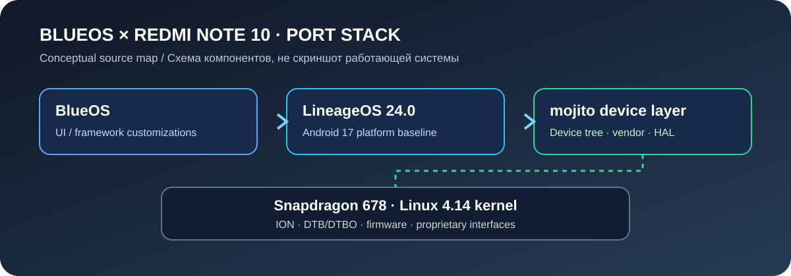
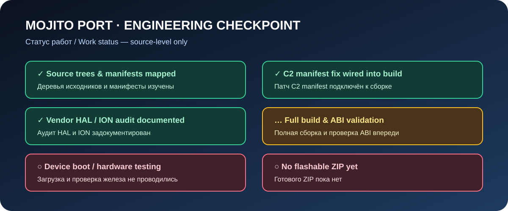

 <div align="center">

# BlueOS for Xiaomi Redmi Note 10

**mojito / sunny · Snapdragon 678 · Android 17 target**

[](#current-status--текущий-статус)
[](https://github.com/LineageOS/android)
[](#device--устройство)

*An independent device bring-up effort for BlueOS.*

</div>

> **RU:** Это экспериментальный порт BlueOS для Xiaomi Redmi Note 10 4G. Сейчас ведётся интеграция исходников и проверка совместимости. Готовой прошивки для установки пока нет.
>
> **EN:** This is an experimental BlueOS bring-up for the Xiaomi Redmi Note 10 4G. Source integration and compatibility work are in progress. There is no installable ROM build yet.

---

## Визуальная схема / Port architecture



*Схема архитектуры исходников, а не скриншот работающего телефона. / Source architecture diagram, not a screenshot of a running phone.*

## Текущий статус / Current status



| Направление / Area | Статус / Status |
|---|---|
| Device, common, kernel and vendor source mapping | Reviewed / Изучено |
| LineageOS 24.0 + Qualcomm CAF dependency mapping | Reviewed / Изучено |
| SM6150 Codec2 vendor manifest ordering | Fix prepared in bring-up branch / Исправление в рабочей ветке |
| Proprietary vendor source files | 455 references inventoried; full existence check pending / 455 ссылок учтено, проверка файлов впереди |
| Soong + ABI validation | Not run / Не выполнялась |
| Full ROM build | Not run / Не выполнялась |
| Boot and hardware tests | Not run / Не выполнялись |
| Flashable ZIP | Not available / Отсутствует |

**Важно / Important:** source-level review does not prove that the ROM builds or boots. No claim of working camera, display, radio, Wi-Fi, fingerprint, audio, or other hardware is made until tested on the actual device.

---

## Что нового в репозитории / New engineering utility

### Vendor blob source auditor

A small Python utility was added to check whether the proprietary source paths referenced by the two Xiaomi vendor makefiles actually exist in a synced Android checkout. This turns the current manual blob inventory into a repeatable check.

```bash
python3 scripts/audit-vendor-blobs.py ~/android/blueos-mojito
```

You can also pass custom makefiles:

```bash
python3 scripts/audit-vendor-blobs.py ~/android/blueos-mojito \
  --makefile vendor/xiaomi/mojito/mojito-vendor.mk \
  --makefile vendor/xiaomi/sm6150-common/sm6150-common-vendor.mk
```

Exit codes: `0` = all parsed source paths exist, `1` = missing source paths, `2` = audit could not run (for example, a makefile is missing or no entries were parsed).

**Scope limitation:** this checks source-file presence for concrete `PRODUCT_COPY_FILES` entries only. It does not validate ELF dependencies, Android ABI compatibility, firmware versions, licenses, VINTF compatibility, or runtime behavior.

---

## Устройство / Device

| Property | Value |
|---|---|
| Device | Xiaomi Redmi Note 10 4G |
| Codenames | `mojito` / `sunny` |
| SoC | Qualcomm Snapdragon 678 |
| CPU architecture | 64-bit ARM |
| Target platform | LineageOS 24.0 / Android 17 |
| Kernel source | Xiaomi mojito tree, branch `17.0` |
| Kernel baseline observed | Linux 4.14.357-openela |

## Исходники / Source baseline

Candidate device, common-device, kernel, and vendor repositories are pinned to branch `17.0` in [the LineageOS device manifest](manifests/mojito-lineage24.xml). BlueOS is pinned separately in [the BlueOS manifest](manifests/blueos.xml).

- Device tree: [ximi-mojito/device_xiaomi_mojito](https://github.com/ximi-mojito/device_xiaomi_mojito)
- SM6150 common tree: [ximi-mojito/device_xiaomi_sm6150-common](https://github.com/ximi-mojito/device_xiaomi_sm6150-common)
- Kernel: [ximi-mojito/android_kernel_xiaomi_mojito](https://github.com/ximi-mojito/android_kernel_xiaomi_mojito)
- Device vendor: [ximi-mojito/android_vendor_xiaomi_mojito](https://github.com/ximi-mojito/android_vendor_xiaomi_mojito)
- Common vendor: [ximi-mojito/android_vendor_xiaomi_sm6150-common](https://github.com/ximi-mojito/android_vendor_xiaomi_sm6150-common)

See [docs/DEVICE_SOURCES.md](docs/DEVICE_SOURCES.md) for the source and compatibility audit, known kernel risks, vendor HAL inventory, and build notes.

## План работ / Roadmap

1. Finish the proprietary-file existence audit in a complete synced checkout.
2. Resolve Soong module and shared-library dependency errors against the pinned LineageOS 24.0 revision.
3. Validate VINTF declarations and vendor service compatibility.
4. Build plain LineageOS for `mojito` before applying the BlueOS layer.
5. Integrate BlueOS and resolve patch failures.
6. Inspect boot/vendor_boot/DTB/DTBO packaging and verify the resulting ZIP.
7. Test boot and core hardware functions on a physical Redmi Note 10, then publish logs and checksums.

## Сборка / Build

A preliminary build wrapper is available at [scripts/build.sh](scripts/build.sh). It expects an x86_64 Linux host, the Android `repo` tool, and at least 350 GB of free SSD space. It has **not** been validated by a complete build in this project environment.

Read [docs/BUILDING.md](docs/BUILDING.md) before using it. Build the plain LineageOS target first, then add BlueOS and inspect all patch output.

## Безопасность / Safety

Do not flash images or ZIPs unless they are explicitly built for `mojito`, verified with checksums, and tested. An incompatible image can erase data or make the phone unable to boot. Keep a separate backup. Never publish signing keys, passwords, or private credentials.

## Links

- BlueOS upstream: https://github.com/GDmio/BlueOS
- BlueOS build guide: https://github.com/GDmio/BlueOS/blob/main/BUILDING.md
- LineageOS source: https://github.com/LineageOS/android
- Active device bring-up branch: [bringup/lineage-17-mojito](https://github.com/h1nchek/BlueOS-mojito/tree/bringup/lineage-17-mojito)

---

<div align="center">

**Community project · Not affiliated with Xiaomi, LineageOS, or the BlueOS upstream maintainers.**

**RU:** Независимый проект сообщества. Неофициальная сборка, не связанная с Xiaomi, LineageOS или разработчиками BlueOS.

</div>
